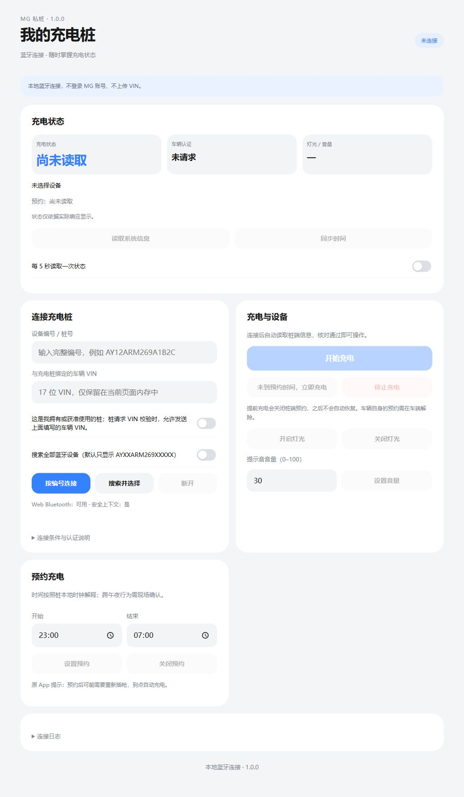

<p align="center">
  
</p>

<h1 align="center">MG 私桩</h1>

<p align="center">
  不登录账号，用手机蓝牙直接连上自家的安悦私人充电桩：看状态、启停充电、预约、灯光、音量。<br>
  Android App · 网页版（Chrome Web Bluetooth）· 微信小程序「SAIC私桩控制」
</p>

<p align="center">
  <a href="../../releases/latest">下载最新 APK</a> ·
  <a href="docs/PROTOCOL.md">协议说明</a> ·
  <a href="CHANGELOG.md">更新记录</a>
</p>

> [!IMPORTANT]
> 这是**非官方**的社区项目，与上汽集团、MG 名爵、MG Live 及充电桩厂商没有任何关系，也未获得其授权或认可；相关名称与商标归各自所有者。
> 只能用于**你自己拥有或获准使用**的充电桩。充电涉及高压电气设备，使用风险自负，详见[免责声明](#免责声明)。

## 为什么做这个

MG Live 里的“私桩”功能需要登录账号，入口还受账号功能权限控制（例如副账号可能看不到控制按钮），网络不好时也不方便。实际上充电桩是通过蓝牙本地控制的：只要手机在桩旁边、知道绑定车辆的 VIN，就能按照原 App 的同一套蓝牙协议完成认证和控制。本项目把这套协议重新实现成一个独立、离线、开源的小工具。

- **不登录**：不调用任何云端接口，不需要 MG 账号。Android 版连 INTERNET 权限都没有申请。
- **不上传**：VIN 只保存在内存里，只在充电桩主动要求认证时通过蓝牙发给桩；日志不记录 VIN。
- **不绕过**：沿用桩端自身的 VIN 校验，不伪造认证结果，也不会给副账号增加任何服务器端权限。

<p align="center"></p>

## 功能

| | |
|---|---|
| 连接 | 扫描并选择（默认只显示 `AYXXARM269XXXXX` 格式的桩），或输入完整编号直接连接 |
| 状态 | 桩号、充电状态、认证状态、灯光、音量、预约时段；可每 5 秒自动刷新 |
| 充电 | 开始 / 停止充电；“未到预约时间，立即充电”（先关闭桩端预约并确认，再启动） |
| 设置 | 预约充电、灯光开关、提示音音量、同步时间 |
| 日志 | 完整收发日志，可导出，VIN 自动隐藏 |

### 安全门禁

控制指令都经过同样的检查，三个版本共用这套逻辑：

- 连接后先读取系统信息；填写了桩号时，返回的桩号必须一致，否则禁用控制。
- 桩请求 VIN 认证时，只有勾选授权才发送；桩返回“VIN 不匹配 / 认证超时”后一直禁用，直到断开重连。
- 一次只发一条指令并等待桩的响应，写入之间至少间隔 120 ms；30 秒超时，**从不自动重发控制指令**。
- “立即充电”在确认桩端预约已关闭之前不会发送启动指令，启动指令只发一次。
- 界面只显示桩实际返回的状态，不把“蓝牙写入成功”当成“充电成功”。

## 下载与使用

### Android（推荐）

1. 在 [Releases](../../releases/latest) 下载 `MG-Pile-x.y.z.apk` 并安装（需 Android 8.0+）。
2. 打开蓝牙，在 App 里填写**与充电桩绑定的车辆 VIN**，勾选授权。
3. 点“搜索并选择”，授予“附近设备”权限（Android 11 及以下还需要位置权限和定位开关），选择自己的桩。
4. 连接后会自动读取并核对桩号，之后就能操作。建议先试灯光，再试启停充电。

App 切到后台会断开蓝牙，回到前台再连就行。**断开蓝牙不等于停止充电。**

### 网页版

需要支持 Web Bluetooth 的浏览器（Windows / Android 上的 Chrome、Edge），页面必须通过 HTTPS 或 `localhost` 打开：

```bash
python build_web.py                     # 生成 dist/index.html（单文件，也可在 Releases 下载）
python -m http.server 8765 -d dist      # 浏览器打开 http://localhost:8765/
```

### 微信小程序「SAIC私桩控制」

小程序版正在等待微信审核，上线后**直接在微信里搜索「SAIC私桩控制」**即可使用，无需下载安装。使用方式与 Android 版相同：打开手机蓝牙并允许微信使用蓝牙（安卓手机还需要位置权限和系统定位开关），填写 VIN 并勾选授权后搜索、连接自己的桩。

源码在 [`miniapp/`](miniapp)。想自己调试或部署，用微信开发者工具导入，并把 `project.config.json` 里的 AppID 换成你自己的。开发者工具连不了真实蓝牙，页面顶部有一个只在开发者工具中显示的“模拟充电桩”开关，用来走通界面流程。详见 [miniapp/README.md](miniapp/README.md)。

## 从源码构建

```bash
npm test                    # 协议、交互门禁、安卓桥接、小程序的全部单元测试（无需任何依赖）
python build_web.py         # 网页版 → dist/index.html
./gradlew assembleRelease   # Android → android/build/outputs/apk/release/MG-Pile-<版本>.apk
```

Android 部分是标准 Gradle 工程，用 Android Studio 直接打开仓库根目录即可构建；签名证书通过 `keystore.properties` 或环境变量配置，见 [android/README.md](android/README.md)。

### 发布（维护者）

推送 `v*` 标签时，GitHub Actions 会构建 APK 和网页单文件并发布到 Releases。发布版必须始终用**同一个证书**签名，否则用户无法覆盖安装更新。在仓库 *Settings → Secrets and variables → Actions* 中添加：

| Secret | 内容 |
|---|---|
| `MGPILE_KEYSTORE_BASE64` | keystore 文件的 base64（`base64 -w0 release.keystore`，Windows：`certutil -encode`） |
| `MGPILE_STORE_PASS` / `MGPILE_KEY_ALIAS` / `MGPILE_KEY_PASS` | keystore 密码、别名、密钥密码 |

没有配置证书时，普通提交仍会构建（使用构建机的调试证书，仅供测试），打标签发布则会直接失败。

## 项目结构

```
web/          网页界面与核心逻辑（Android 版也打包这套界面）：protocol.js（帧构造/解析）、app.js（连接、认证、控制门禁）
android/      Android 外壳：原生 BLE（MainActivity.java）+ WebView，native-ble.js 把原生蓝牙桥接成 Web Bluetooth 接口
miniapp/      微信小程序：utils/protocol.js、ble.js（wx 蓝牙）、controller.js（同一套控制逻辑）
tests/        单元测试与模拟充电桩
docs/         协议说明（PROTOCOL.md）与验证记录
```

## 协议速览

服务 `FFF0`；普通指令写 `FFF3`，VIN 原始字节写 `FFF6`；订阅 `FFF4 / FFF5 / FFF9`。帧格式 `68 CMD 00 00 LEN_LO LEN_HI 00 XOR PAYLOAD`，响应帧头 `AA`，整帧异或为 0。

| 指令 | 作用 | 指令 | 作用 |
|---|---|---|---|
| `B1` | 读取系统信息 | `B4` | 开始充电 |
| `B0` | 同步时间 | `B6` | 停止充电 |
| `B2` | 音量 | `A0` | 灯光 |
| `B3` | 预约 | | |

`FFF5` 通知：`0A` = 桩请求 VIN，`55` = VIN 不匹配，`54` = 认证超时。完整字段见 [docs/PROTOCOL.md](docs/PROTOCOL.md)。

## 兼容性与已知限制

- 协议来自 MG Live 2.2.6 安卓客户端，面向安悦（`AYXXARM269XXXXX`）私人充电桩。其他品牌或固件版本的桩可能不兼容；欢迎提交 issue 并附上导出的日志（分享前请检查日志中的桩号等信息）。
- 早期版本已在作者的实桩上连接使用；“立即充电”流程和微信小程序尚未在真实充电桩上完整验证。小程序上线前以 Android 版为准。
- 车辆自身设置的预约充电，桩端无法代为解除；部分桩在关闭预约后需要重新插枪。
- 预约时间按桩的本地时钟解释，跨午夜的行为请现场确认。

## 隐私

不收集、不上传任何数据。VIN 只在内存中，只在桩请求认证时经蓝牙发给桩；导出的日志会隐藏 VIN，但仍可能包含桩号和蓝牙设备名。

## 免责声明

本项目通过分析官方客户端的蓝牙通信实现互通，仓库中不包含任何官方客户端的代码、图片或其他资源。软件按“原样”提供，不附带任何担保。使用本软件控制充电设备所产生的任何后果（包括但不限于设备损坏、车辆问题、保修失效、财产损失）由使用者自行承担。请只在你有权使用的设备上使用，并遵守当地法律法规和充电桩的使用条款。

## 许可证

[MIT](LICENSE)
